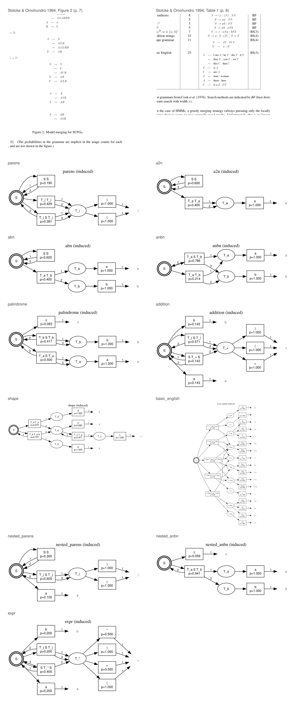

An implementation of stochastic context free grammar induction, following Stolcke and Omohundro's
[Inducing Probabilistic Grammars by Bayesian Model Merging](https://arxiv.org/abs/cmp-lg/9409010) (ICGI 1994).

  

We start from the most specific grammar the data permits: every sample contributes its own production, and every terminal that occurs gets a corresponding nonterminal. At this stage there's effectively no sharing between samples, so the grammar is just memorising the corpus rather than generalising beyond it.

From there, we generalise with two operators, merging and chunking. Merging takes a pair of nonterminals and folds them into a single nonterminal containing the union of their productions; chunking replaces a contiguous sequence of symbols with a fresh nonterminal. Chunking doesn't itself change the language the grammar generates, but it changes the internal structure in a way that can expose useful merges which weren't previously available.

We rank candidate grammars with a structural description length and an approximate evidence objective. The default scorer fits production probabilities with expectation maximisation, computes fractional expected production counts, and applies a symmetric Dirichlet correction. Maximum likelihood and a variational evidence lower bound are also available.

We explore the resulting grammar space using either beam or best first search, then fit the parameters by expectation maximisation once the grammar structure is fixed. Parsing is a generalised CYK or inside computation over spans, which lets the grammar be scored directly without an intermediate conversion into Chomsky normal form.
